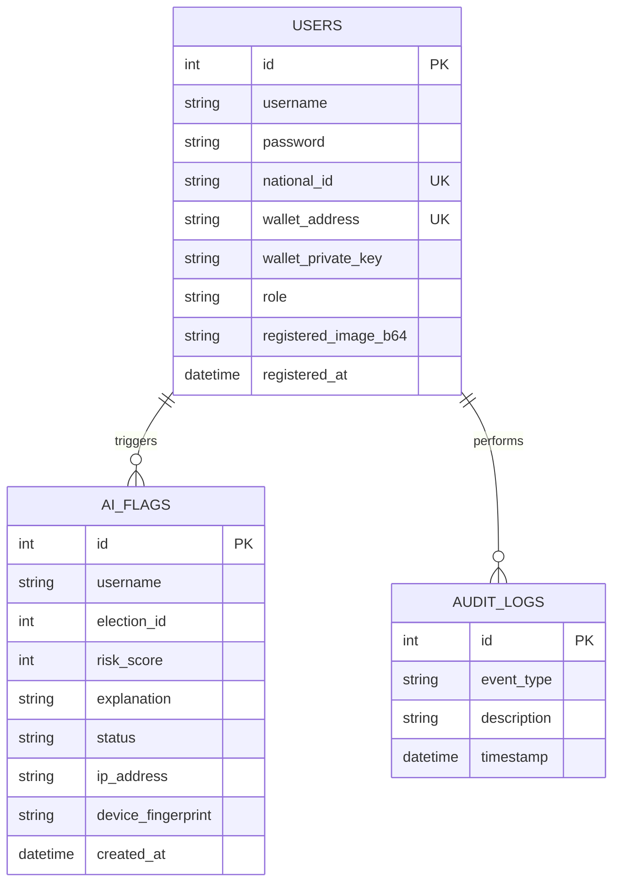

# System Architecture & Design Specification

This document details the high-level architecture, data flows, process mapping, and database entity relationships of the Blockchain-Based AI-Integrated Online Voting System.

---

## 1. System Context Diagram (Level 0 Context)

The context diagram illustrates how the core voting platform interacts with external actors: Voters, Administrators, the Python AI microservice, the EVM Ganache blockchain ledger, and the SQLite metadata store.

```mermaid
graph TD
    Voter([Voter]) ── Registration data, Biometrics & Votes ──► System[AGY-Vote System]
    Admin([Administrator]) ── Create Elections, Add Candidates & Review Flags ──► System
    System ── Face verify request, Risk features ──► AIEngine([AI Flask Engine])
    AIEngine ── Face Match Score, Behavioral Risk Score ──► System
    System ── Signed transactions ──► Blockchain([Ganache EVM Ledger])
    Blockchain ── Block Numbers & Transaction Receipts ──► System
    System ── Log entries, Voter profile metadata ──► AppDB[(SQLite App DB)]
```

---

## 2. Data Flow Diagram (DFD Level 0)

This diagram details the flow of data through the core processes of registration, identity verification, vote casting, ledger recording, and auditing.

```mermaid
graph TD
    subgraph DFD Level 0 Processes
        P1[1. User Registration]
        P2[2. Biometric & Security scan]
        P3[3. Ballot Casting]
        P4[4. Blockchain Ledger Recording]
        P5[5. Result & Audit Explorer]
    end

    Voter([Voter]) ── 1. Registration data ──► P1
    P1 ── 2. Biometric Verification Request ──► P2
    P2 ── 3. Biometric Match result & Deduplication status ──► P1
    P1 ── 4. Save Voter & seed on-chain wallet ──► DB[(SQLite DB)]

    Voter ── 5. Camera Snapshot & ballot choices ──► P3
    P3 ── 6. Behavior features & client metadata ──► P2
    P2 ── 7. Generate Flag if risk score >= 40 ──► DB
    
    P3 ── 8. Broadcast transaction ──► P4
    P4 ── 9. Write transaction block ──► Ledger[(Ganache EVM Ledger)]
    P4 ── 10. Tx Hash receipt ──► Voter

    P5 ── 11. Read block numbers & tally counts ──► Ledger
    P5 ── 12. Display metrics & audit receipts ──► ExplorerUI([Explorer View])
```

---

## 3. Entity Relationship Diagram (ERD)

The database schema manages user accounts, security logs, and audit logs. The vote ledger itself exists in a decoupled state on the EVM smart contract, maintaining voter privacy.


